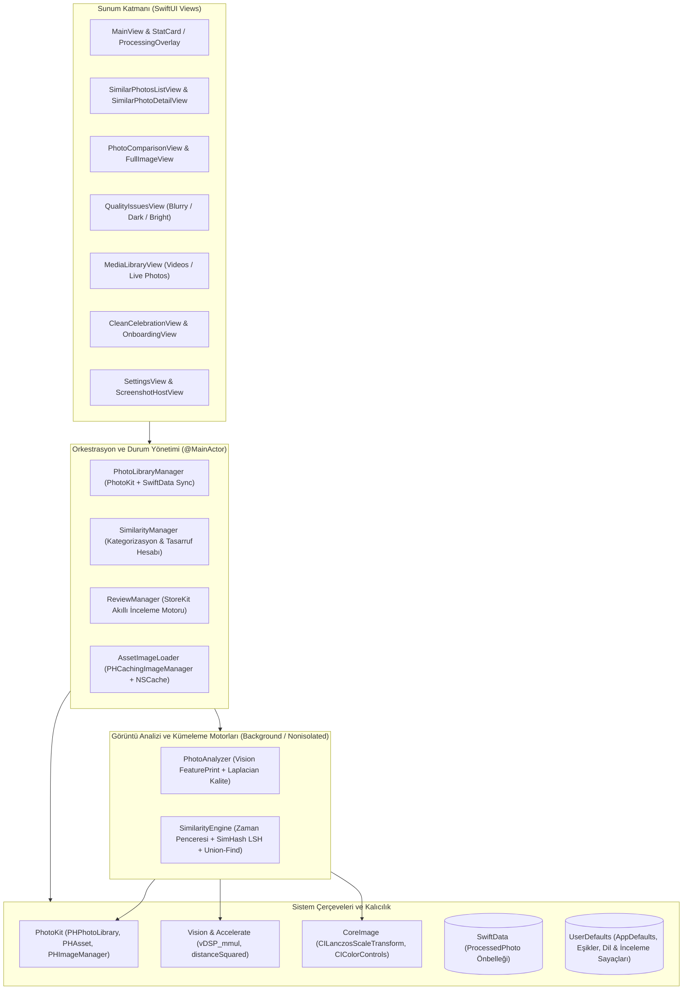
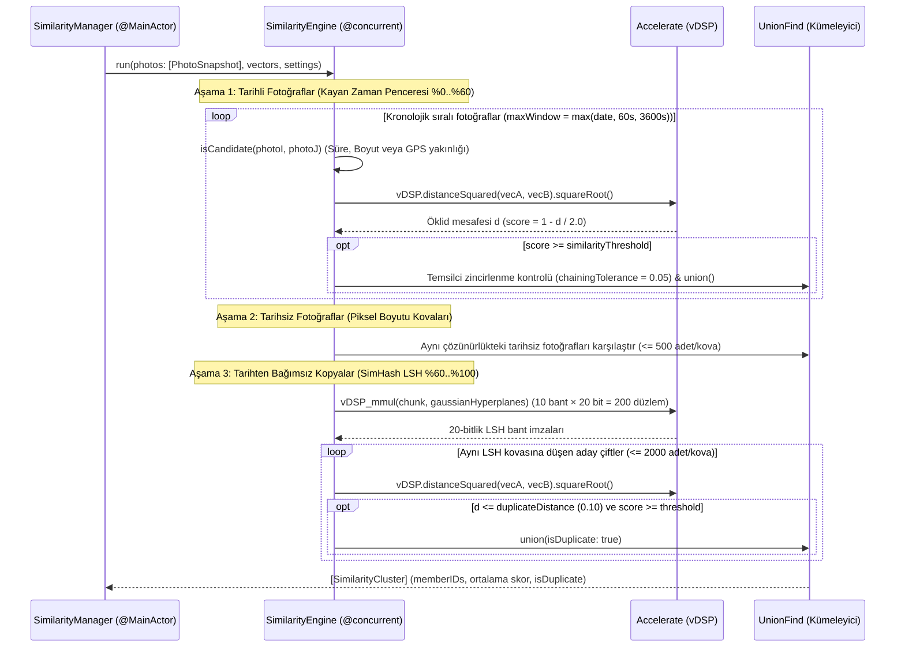

# Similarly — Sistem Mimarisi (Architecture)

Bu doküman, **Similarly** iOS uygulamasının katmanlı mimarisini, Vision ve Accelerate tabanlı görüntü benzerlik/kopya algılama motorunu, kalite analizi (bulanıklık/parlaklık) boru hattını, PhotoKit entegrasyonunu, SwiftData önbellekleme mekanizmasını ve eşzamanlılık/bellek yönetimi stratejilerini açıklar.

---

## 1. Mimari Genel Bakış

Similarly, **Swift Concurrency (`async/await`, `@MainActor`, `@concurrent`, `Sendable`, `TaskGroup`)**, **SwiftUI**, **Vision (`GenerateImageFeaturePrintRequest`)**, **Accelerate (`vDSP`)**, **CoreImage** ve **SwiftData** üzerine inşa edilmiş, %100 cihaz içi (on-device) ve yerel öncelikli (local-first) bir mimariye sahiptir. Hiçbir fotoğraf veya analiz verisi üçüncü taraf bir sunucuya gönderilmez; tüm görsel öznitelik çıkarımı (feature print), kalite ölçümü ve kümeleme işlemleri cihaz üzerinde gerçekleştirilir.



---

## 2. Dizin ve Modül Yapısı

```text
Similarly/
├── SimilarlyApp.swift                      # Uygulama giriş noktası, SwiftData ModelContainer kurulumu ve otomatik şema kurtarma
├── Models/
│   ├── PhotoItem.swift                     # Bellek içi hafif fotoğraf modeli (PhotoItem) ve grup modeli (SimilarPhotoGroup)
│   └── ProcessedPhoto.swift                # SwiftData @Model önbellek kaydı, AnalysisVersion ve FeaturePrintCoding
├── Managers/
│   ├── PhotoLibraryManager.swift           # PhotoKit erişimi, artımlı (incremental) analiz, PHPhotoLibraryChangeObserver ve silme işlemleri
│   ├── PhotoAnalyzer.swift                 # Arka plan görüntü yükleme, Vision FeaturePrint üretimi ve Laplacian bulanıklık/parlaklık hesabı
│   ├── SimilarityEngine.swift              # Kayan zaman penceresi, SimHash LSH kopya taraması ve Union-Find kümeleme motoru
│   ├── SimilarityManager.swift             # Grupların ayrıştırılması (Kopya/Screenshot/Benzer), kalite filtreleme ve potansiyel tasarruf hesabı
│   ├── AssetImageLoader.swift              # Paylaşımlı PHCachingImageManager ve 100 MB limitli NSCache küçük resim yükleyicisi
│   └── ReviewManager.swift                 # StoreKit tabanlı, etki ve bekleme süresi (cooldown) kurallı puanlama yöneticisi
├── Views/
│   ├── MainView.swift                      # Ana gösterge paneli, özet StatCard'lar ve ilerleme katmanları (ProcessingOverlay)
│   ├── SimilarPhotosListView.swift         # Sayfalamalı (paginated) grup listesi, SimilarPhotoDetailView ve FullImageView
│   ├── PhotoComparisonView.swift           # 2 sütunlu yan yana fotoğraf karşılaştırma ve seçim ekranı
│   ├── QualityIssuesView.swift             # Bulanık, karanlık ve aşırı parlak fotoğraflar için 3 sekmeli inceleme ve muafiyet ekranı
│   ├── MediaLibraryView.swift              # Büyük videolar ve Live Photo'lar için 2 sekmeli medya temizleme ekranı
│   ├── CleanCelebrationView.swift          # Silme sonrası kazanılan alanı gösteren kutlama ve paylaşım ekranı
│   ├── OnboardingView.swift                # 4 adımlı tam ekran karşılama akışı
│   ├── SettingsView.swift                  # 8 dil seçimi, 3 hazır ayar profili (Hassas/Dengeli/Esnek) ve özel eşik kaydırıcıları
│   └── ScreenshotHostView.swift            # App Store ekran görüntüsü otomasyonu için "--screenshot <N>" başlatma sunucusu
├── Utilities/
│   ├── AppSettings.swift                   # AppDefaults sabitleri ve UserDefaults.doubleValue(forKey:default:) uzantısı
│   ├── L10n.swift                          # 8 dil destekli dinamik yerelleştirme ve birleşik Locale biçimlendiricisi
│   └── PHAsset+SafeTargetSize.swift        # Ultra geniş/dar görsellerde Nx0 çökmesini önleyen güvenli hedef boyut hesaplayıcısı
└── SimilarlyTests/
    ├── PhotoItemTests.swift                # Kalite eşikleri ve tahmini dosya boyutu birim testleri
    ├── SimilarityEngineTests.swift         # Vektör kümeleme ve ayrıştırma birim testleri
    └── ReviewManagerTests.swift            # StoreKit inceleme kuralları ve 30 günlük bekleme süresi birim testleri
```

---

## 3. Veri Katmanı ve Kalıcılık (SwiftData & UserDefaults)

### 3.1. SwiftData Analiz Önbelleği ([ProcessedPhoto.swift](file:///Users/tamersavasci/Documents/Similarly/Similarly/Models/ProcessedPhoto.swift) & [SimilarlyApp.swift](file:///Users/tamersavasci/Documents/Similarly/Similarly/SimilarlyApp.swift))
Her fotoğrafın Vision öznitelik vektörünü ve kalite skorlarını uygulama her açıldığında yeniden hesaplamamak için sonuçlar **SwiftData** üzerinde önbelleklenir:

- **`ProcessedPhoto` (`@Model`):**
  - `@Attribute(.unique) var id: String`: `PHAsset.localIdentifier` değerini birincil anahtar olarak tutar.
  - `featurePrint: Data?`: Vision'dan alınan `[Float]` vektörünün [`FeaturePrintCoding`](file:///Users/tamersavasci/Documents/Similarly/Similarly/Models/ProcessedPhoto.swift#L59-L69) ile sıfır kopya (`withUnsafeBufferPointer`) ham baytlara dönüştürülmüş halidir.
  - `blurScore: Double?` ve `brightnessScore: Double?`: Hesaplanan bulanıklık (Laplacian varyansı) ve parlaklık (0–1 arası ortalama lüminans) değerleri.
  - `modificationDate: Date?` ve `analysisVersion: Int`: Fotoğraf düzenlendiğinde veya [`AnalysisVersion.current`](file:///Users/tamersavasci/Documents/Similarly/Similarly/Models/ProcessedPhoto.swift#L12-L14) (`3`) artırıldığında eski kayıtların geçersiz kılınmasını sağlar.
  - `qualityDismissed: Bool`: Kullanıcının "Bulanık Değil / Kalite Sorunu Yok" olarak işaretlediği fotoğrafları kalıcı olarak muaf tutar.
- **Kendi Kendini Onaran Veritabanı Başlatma ([`SimilarlyApp.init()`](file:///Users/tamersavasci/Documents/Similarly/Similarly/SimilarlyApp.swift#L26-L49)):**
  - `ModelContainer` oluşturulmadan önce `Application Support` dizininin varlığı garanti altına alınır.
  - Veritabanı yalnızca yeniden üretilebilir analiz önbelleği olduğundan, bir şema uyumsuzluğu veya bozulma durumunda `.store`, `-shm` ve `-wal` dosyaları otomatik olarak temizlenip `ModelContainer` sıfırdan oluşturulur.

### 3.2. Bellek İçi Hafif Model ve Vektör Ayrımı ([PhotoItem.swift](file:///Users/tamersavasci/Documents/Similarly/Similarly/Models/PhotoItem.swift))
- [`PhotoItem`](file:///Users/tamersavasci/Documents/Similarly/Similarly/Models/PhotoItem.swift#L14-L113), SwiftUI görünümlerinde yüksek performansla kopyalanabilmesi için **768 boyutlu `Float` vektörlerini kendi içinde taşımaz**.
- Bunun yerine öznitelik vektörleri [`PhotoLibraryManager.featurePrints`](file:///Users/tamersavasci/Documents/Similarly/Similarly/Managers/PhotoLibraryManager.swift#L47) (`[String: [Float]]`) sözlüğünde merkezi olarak tutulur.
- `PhotoItem.estimatedFileSize`, gerçek dosya boyutu (`cachedFileSize`) henüz okunmamışsa HEIC/JPEG ortalamasına dayalı olarak `Int64(pixelWidth * pixelHeight) / 5` (piksel başına ~0.2 bayt) formülüyle anlık alan tasarrufu tahmini üretir.

---

## 4. Görüntü Analizi, Vision FeaturePrint ve Kalite Motoru

### 4.1. Eşzamanlı Görüntü Analiz Boru Hattı ([PhotoAnalyzer.swift](file:///Users/tamersavasci/Documents/Similarly/Similarly/Managers/PhotoAnalyzer.swift))
[`PhotoLibraryManager.processPendingPhotos()`](file:///Users/tamersavasci/Documents/Similarly/Similarly/Managers/PhotoLibraryManager.swift#L186-L209), henüz analiz edilmemiş veya analiz sürümü eski olan fotoğrafları **32'lik partiler (`analysisBatchSize = 32`)** halinde [`PhotoAnalyzer.analyze(localIdentifiers:)`](file:///Users/tamersavasci/Documents/Similarly/Similarly/Managers/PhotoAnalyzer.swift#L41-L64) metoduna gönderir:

1. **Sınırlı Eşzamanlılık (`maxConcurrency = 4`):** Bellek taşmasını önlemek için her 32'lik parti `withTaskGroup` içinde en fazla 4 paralel alt göreve bölünür. Her alt görev kendi `PHAsset` nesnelerini yerel olarak çeker (`Sendable` güvenliği).
2. **Standart Çözünürlükte Görüntü Yükleme (`requestEdge = 512`):**
   - Vision `FeaturePrint` çıktısı girdi çözünürlüğüne duyarlı olduğu için tüm fotoğraflar [`safeAspectFitTargetSize`](file:///Users/tamersavasci/Documents/Similarly/Similarly/Utilities/PHAsset+SafeTargetSize.swift#L14-L42) ile uzun kenarı `512 px` (minimum kenar `8 px`) olacak şekilde `.highQualityFormat` ve `.exact` yeniden boyutlandırma moduyla istenir.
   - PhotoKit geri çağrılarının asılı kalmasına karşı `OSAllocatedUnfairLock` korumalı `resumeOnce` mekanizması ve **15 saniyelik (`imageTimeout = 15`)** güvenlik zaman aşımı uygulanır.
3. **Vision Öznitelik Çıkarımı (`GenerateImageFeaturePrintRequest`):**
   - Gerçek cihazda Apple Vision çerçevesinin `GenerateImageFeaturePrintRequest().perform(on: cgImage, orientation: orientation)` API'si çalıştırılarak birim normlu `[Float]` öznitelik vektörü elde edilir.
   - Simülatör ortamında (`#if targetEnvironment(simulator)`), Espresso sinir ağı bağlamı bulunmadığından görüntüyü `16×16` RGB piksel matrisine indirgeyen 768 boyutlu, ortalaması çıkarılmış ve birim normlu [`simulatorFeatureVector`](file:///Users/tamersavasci/Documents/Similarly/Similarly/Managers/PhotoAnalyzer.swift#L183-L218) yedek algoritması devreye girer.
4. **Tek Geçişli Bulanıklık ve Parlaklık Ölçümü ([`measureQuality(of:)`](file:///Users/tamersavasci/Documents/Similarly/Similarly/Managers/PhotoAnalyzer.swift#L225-L294)):**
   - Görüntü `CILanczosScaleTransform` ile uzun kenarı en fazla `256 px` (`qualityEdge`) olacak şekilde küçültülür ve `CIColorControls` (`saturation = 0`) ile gri tonlamaya çevrilir.
   - [`laplacianVarianceAndBrightness`](file:///Users/tamersavasci/Documents/Similarly/Similarly/Managers/PhotoAnalyzer.swift#L261-L294) fonksiyonu tek bir piksel tamponu geçişinde:
     - **Bulanıklık Skoru (`blurScore`):** 4 komşulu ayrık Laplacian operatörü ($4I(x,y) - I(x,y-1) - I(x,y+1) - I(x-1,y) - I(x+1,y)$) uygulayarak **Laplacian varyansını** hesaplar. Düşük varyans (`<= blurThreshold`, varsayılan `100.0`) kenar keskinliğinin az olduğunu, yani fotoğrafın bulanık olduğunu gösterir.
     - **Parlaklık Skoru (`brightnessScore`):** Ortalama piksel lüminansını `[0.0, 1.0]` aralığında normalize eder (`<= 0.2` karanlık, `>= 0.9` aşırı parlak).

---

## 5. Benzerlik ve Kopya Kümeleme Motoru ([SimilarityEngine.swift](file:///Users/tamersavasci/Documents/Similarly/Similarly/Managers/SimilarityEngine.swift))

Tüm fotoğrafların birbirleriyle karesel ($O(N^2)$) karşılaştırılması büyük galerilerde mümkün olmadığından, `SimilarityEngine` **3 aşamalı hibrit bir aday üretme ve `UnionFind` kümeleme** algoritması çalıştırır:



### 5.1. Algoritmik Detaylar ve Sabitler
1. **Mesafe ve Skor Formülü:** Birim normlu Vision vektörleri arasındaki Öklid mesafesi `vDSP.distanceSquared(a, b).squareRoot()` ile `[0, 2]` aralığında ölçülür ve `score = max(0, 1 - d / 2.0)` formülüyle `[0, 1]` benzerlik skoruna dönüştürülür. Mesafesi `duplicateDistance = 0.10` altında olan çiftler (`score >= 0.95`) **kopya (duplicate)** kenarı olarak işaretlenir.
2. **Aşama 1 — Kayan Zaman Penceresi (`isCandidate`):** Fotoğraflar çekim tarihine göre sıralanır ve yalnızca şu 3 koşuldan birini sağlayan çiftler karşılaştırılır:
   - Çekim süreleri farkı `<= settings.dateThresholdSeconds` (varsayılan `5 sn`, seri çekimler).
   - Süre farkı `<= 60 sn` (`sameSizeTimeWindow`) ve piksel sayıları farkı `< %10`.
   - Süre farkı `<= 3600 sn` (`locationTimeWindow`) ve GPS koordinatları arasındaki mesafe `<= settings.locationThresholdMeters` (varsayılan `100 m`).
3. **Aşama 2 — Tarihsiz Fotoğraf Kovaları:** EXIF tarihi bulunmayan fotoğraflar `SizeKey(width, height)` anahtarıyla gruplanır; karesel patlamayı önlemek için yalnızca boyutu `<= 500` (`maxUndatedBucketSize`) olan kovalardaki fotoğraflar kendi içinde karşılaştırılır.
4. **Aşama 3 — SimHash / Rastgele Hiper-Düzlem LSH (Tarihten Bağımsız Kopya Taraması):**
   - Farklı tarihlerde indirilmiş veya yeniden kaydedilmiş birebir kopyaları yakalamak için `SplitMix64(seed: 0x5EED_51A1_1A2B_C3D4)` deterministik üreteci ve Box-Muller dönüşümüyle `dimension × 200` boyutunda standart normal dağılımlı bir hiper-düzlem matrisi üretilir.
   - `512`'lik vektör blokları `vDSP_mmul` ile tek seferde matris çarpımına sokularak her fotoğraf için **10 bant × 20 bit (`lshBands = 10`, `lshBitsPerBand = 20`)** SimHash imzası üretilir.
   - $d \le 0.10$ olan iki kopyanın en az bir bantta çakışma olasılığı **~%99.9** iken, alakasız iki fotoğrafın ($d \approx 0.9$) çakışma olasılığı **~%0.8**'dir.
5. **Geçişli Zincirlenme Koruması (`chainingTolerance = 0.05`):** A fotoğrafı B'ye, B de C'ye benzediğinde A ile C'nin alakasız olmasına rağmen aynı grupta birleşmesini (transitive chaining) engellemek için [`UnionFind`](file:///Users/tamersavasci/Documents/Similarly/Similarly/Managers/SimilarityEngine.swift#L362-L433) her kümenin en çok kenara sahip temsilcisini (`representative`) saklar. İki küme birleştirilmeden önce temsilcilerinin de en az `threshold - 0.05` benzerlikte olması şart koşulur.

---

## 6. Kategorizasyon, Medya Tespiti ve Canlı Kütüphane Senkronizasyonu

### 6.1. Grup Ayrıştırma ve Favori Koruması ([SimilarityManager.swift](file:///Users/tamersavasci/Documents/Similarly/Similarly/Managers/SimilarityManager.swift))
- [`categorizeGroups(_:)`](file:///Users/tamersavasci/Documents/Similarly/Similarly/Managers/SimilarityManager.swift#L145-L168), `SimilarityEngine`'den dönen kümeleri 3 ana kategoriye ayırır:
  1. **`duplicateGroups`:** Tüm birleştirme kenarları `isDuplicate == true` ($d \le 0.10$) olan birebir/yeniden sıkıştırılmış kopya grupları.
  2. **`screenshotGroups`:** Kopya olmayan ancak tüm üyeleri `mediaSubtypes.contains(.photoScreenshot)` olan ekran görüntüsü grupları.
  3. **`similarGroups`:** Geriye kalan benzer fotoğraf ve seri çekim grupları.
- **En İyi Fotoğrafı İlk Sıraya Yerleştirme ([`sortGroupWithFavoritesFirst`](file:///Users/tamersavasci/Documents/Similarly/Similarly/Managers/SimilarityManager.swift#L170-L189)):** Her grubun içindeki fotoğraflar (1) Favori durumu (`isFavorite == true`), (2) En yüksek piksel çözünürlüğü (`pixelWidth * pixelHeight`) ve (3) En yeni çekim tarihi sırasıyla dizilir. Böylece ilk sıradaki fotoğraf "korunacak en iyi fotoğraf" kabul edilir ve [`recalculateSavings()`](file:///Users/tamersavasci/Documents/Similarly/Similarly/Managers/SimilarityManager.swift#L299-L304) potansiyel alan kazancını `group.photos.dropFirst()` üzerinden hesaplar.
- **Büyük Medya ve Kalite Sorunları:**
  - `videos` (`mediaType == .video`) ve `livePhotos` (`mediaSubtypes.contains(.photoLive)`) doğrudan filtrelenerek [`MediaLibraryView`](file:///Users/tamersavasci/Documents/Similarly/Similarly/Views/MediaLibraryView.swift) ekranına sunulur.
  - `blurryPhotos`, `darkPhotos` ve `brightPhotos` listeleri `qualityDismissed == false` olan fotoğraflardan oluşturulur ve en sorunlu skordan başlayarak sıralanır.

### 6.2. PhotoKit Değişiklik Gözlemcisi ve Yeniden Analizsiz Silme ([PhotoLibraryManager.swift](file:///Users/tamersavasci/Documents/Similarly/Similarly/Managers/PhotoLibraryManager.swift))
- **Anlık Yerel Temizlik (`removeLocally` & `onPhotosRemoved`):** Kullanıcı uygulama içinden fotoğraf sildiğinde [`deletePhotos(_:)`](file:///Users/tamersavasci/Documents/Similarly/Similarly/Managers/PhotoLibraryManager.swift#L360-L386) `PHPhotoLibrary.shared().performChanges` çağrısını tamamlar tamamlamaz silinen kimlikleri `photos` dizisinden, `featurePrints` sözlüğünden ve SwiftData'dan kaldırır; ardından `onPhotosRemoved` geri çağrısıyla [`SimilarityManager.removePhotos(ids:)`](file:///Users/tamersavasci/Documents/Similarly/Similarly/Managers/SimilarityManager.swift#L225-L245) metodunu tetikler. Böylece **yeniden analiz çalıştırılmadan** tüm gruplar ve tasarruf miktarı anında güncellenir (tek fotoğrafı kalan gruplar otomatik düşürülür).
- **Dış Değişiklik Yönetimi (`photoLibraryDidChange`):** Uygulama dışından (iOS Fotoğraflar uygulamasından) yapılan ekleme, silme ve düzenlemeler `PHPhotoLibraryChangeObserver` ile yakalanır. Yalnızca favori/albüm gibi üstveri değişikliklerinde (`assetContentChanged == false`) mevcut Vision analizi korunup sadece `modificationDate` güncellenir; görsel düzenlenmişse (`assetContentChanged == true`) analiz sıfırlanır ve `scheduleBackgroundAnalysis()` ile 1 saniyelik birleştirme (debounce) sonrasında arka plan analizi başlatılır.
- **Yetim Kayıt Temizliği (`cleanupOrphanedProcessedPhotos`):** Fotoğraf izni `.limited` değilse (tam erişim varsa), kütüphanede artık bulunmayan fotoğraflara ait `ProcessedPhoto` kayıtları SwiftData'dan otomatik temizlenir.

---

## 7. Bellek Yönetimi ve Görüntü Önbellekleme ([AssetImageLoader.swift](file:///Users/tamersavasci/Documents/Similarly/Similarly/Managers/AssetImageLoader.swift))

1. **Paylaşımlı `PHCachingImageManager` ve `NSCache`:** Liste ve ızgara görünümlerindeki her hücre için yeni bir `PHCachingImageManager` oluşturmak yerine tüm uygulama tek bir statik örnek ve **~100 MB maliyet limitli (`totalCostLimit = 100 * 1024 * 1024`)** `NSCache<NSString, UIImage>` paylaşır.
2. **İptal Edilebilir İstekler:** Hücre ekrandan çıktığında (`deinit`) veya yeni bir yükleme başladığında (`cancel()`) devam eden `PHImageRequestID` derhal iptal edilir.
3. **Tam Ekran Alt Örnekleme ([`FullImageView.downsampleImage`](file:///Users/tamersavasci/Documents/Similarly/Similarly/Views/SimilarPhotosListView.swift#L974-L1003)):** Tam ekran önizlemede yüksek çözünürlüklü RAW/48MP fotoğrafların belleği şişirmemesi için görüntü verisi `CGImageSourceCreateThumbnailAtIndex` ile arka planda (`@concurrent`) ekranın piksel boyutuna (`maxPixelSize`) indirgenerek decode edilir.

---

## 8. StoreKit Akıllı Puanlama Yöneticisi ([ReviewManager.swift](file:///Users/tamersavasci/Documents/Similarly/Similarly/Managers/ReviewManager.swift))

Similarly'de ücretli abonelik veya özellik kilidi (Paywall) yoktur; tüm özellikler kullanıcıya açık sunulur. StoreKit entegrasyonu, kullanıcı memnuniyetinin en yüksek olduğu anda App Store değerlendirmesi istemek üzere [`ReviewManager`](file:///Users/tamersavasci/Documents/Similarly/Similarly/Managers/ReviewManager.swift#L15-L121) tarafından yönetilir:
- Her başarılı silme işleminden sonra `recordSuccessfulClean(deletedPhotosCount:savedBytes:)` çağrılır ve ömür boyu silinen fotoğraf (`review_lifetime_photos_deleted`), kazanılan alan (`review_lifetime_bytes_saved`) ve temizlik sayısı (`review_successful_clean_count`) `UserDefaults` üzerinde biriktirilir.
- `shouldRequestReview` şu 3 kapıyı doğrulamadan `AppStore.requestReview(in:)` çağrılmaz:
  1. Mevcut uygulama sürümünde (`CFBundleShortVersionString`) daha önce puanlama istenmemiş olması.
  2. Son puanlama isteminden bu yana en az **30 gün (`cooldownDays = 30`)** geçmiş olması.
  3. Kullanıcının anlamlı fayda sağlamış olması: Tek seferde **≥ 3 fotoğraf** veya **≥ 15 MB** temizlemiş olması (`isHighImpactClean`) VEYA en az **2 başarılı temizlikte toplam ≥ 5 fotoğraf** silmiş olması (`isExperiencedUser`).
