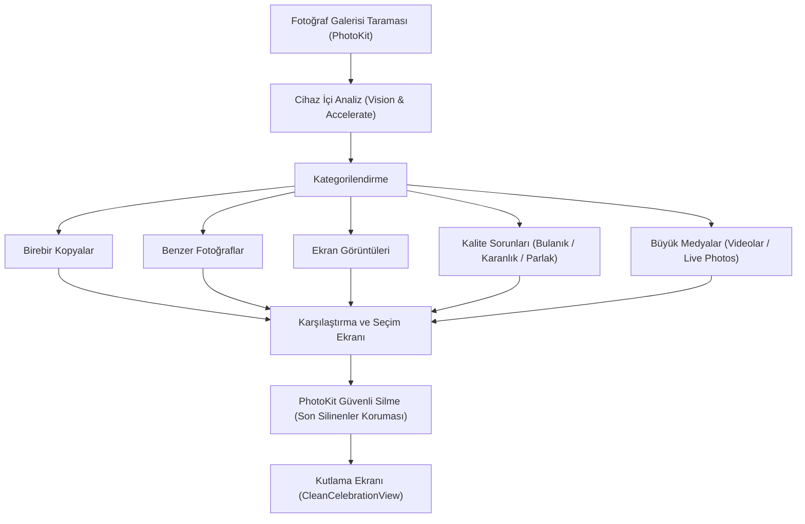

# Similarly — Ürün Gereksinim Dokümanı (PRD)

> **Sürüm:** 1.0  
> **Platform:** iOS 18.0+ (iPhone & iPad)  
> **Durum:** Canlı Geliştirme  
> **Konumlandırma:** %100 Cihaz İçi (On-Device), Yapay Zeka Destekli Akıllı Galeri Temizleyici ve Benzer Fotoğraf Yöneticisi

---

## 1. Ürün Özeti ve Vizyonu

**Similarly**, iPhone ve iPad kullanıcılarının fotoğraf galerilerinde biriken binlerce yinelenen, benzer, bulanık, karanlık ve gereksiz medya dosyasını (büyük videolar, ekran görüntüleri, Live Photo'lar) saniyeler içinde tespit edip güvenle temizlemelerini sağlayan yeni nesil bir galeri optimizasyon uygulamasıdır.

Uygulamanın temel felsefesi:
- **Tam Gizlilik (Zero-Cloud / On-Device Only):** Hiçbir fotoğraf, piksel veya analiz verisi sunucuya yüklenmez. Tüm Vision ve makine öğrenimi modelleri doğrudan cihazın Neural Engine / Apple Silicon donanımında çalışır.
- **Akıllı ve Güvenli Eleme:** Kullanıcının en iyi pozu kolayca seçebilmesi için keskinlik ve kalite metriklerine göre "En İyi Fotoğrafı" otomatik önerir, favori fotoğrafları kazara silinmelere karşı korur.
- **Hafif ve Hızlı:** Apple'ın `Vision` ve `Accelerate (vDSP)` çerçeveleri ile 20.000+ fotoğraflık dev arşivlerde bile pil ve belleği tüketmeden çalışır.

---

## 2. Hedef Kitle ve Kullanıcı Personaları

### 2.1. Depolama Sıkıntısı Yaşayan Günlük Kullanıcı (Storage Conscious)
- **Profil:** 64GB/128GB iPhone kullanan, "iCloud Saklama Alanı Dolu" uyarısı alan kullanıcı.
- **İhtiyaç:** Tek tıkla gereksiz kopyaları ve ekran görüntülerini silerek anında birkaç GB yer açmak.

### 2.2. Seri Çekim Yapan Ebeveyn ve Gezgin (Burst & Travel Photographer)
- **Profil:** En iyi kareyi yakalamak için aynı anın 10-15 fotoğrafını çeken, sonrasında ayıklamaya vakit bulamayan kullanıcılar.
- **İhtiyaç:** Benzer açı ve zaman diliminde çekilmiş fotoğrafların bir arada sunulması, en net/parlak olanın vurgulanması ve geri kalanların tek dokunuşla silinmesi.

### 2.3. Gizlilik Hassasiyeti Yüksek Kullanıcı (Privacy First Advocate)
- **Profil:** Fotoğraflarının bulut tabanlı üçüncü parti sunucularda taranmasını ve yapay zeka eğitiminde kullanılmasını istemeyen kullanıcılar.
- **İhtiyaç:** İnternet bağlantısı olmasa dahi çalışan, çevrimdışı ve açık şeffaf gizlilik garantisi.

---

## 3. Temel Özellikler ve Kullanıcı Deneyimi

### 3.1. Akıllı Analiz ve Kümeleme Motoru
- **Kayan Zaman Penceresi (Sliding Time Window):** Yakın zaman dilimlerinde (varsayılan: 120 saniye) çekilen fotoğraflar ön filtrelemeye alınır.
- **Vision FeaturePrint & SimHash LSH:** Apple'ın `VNGenerateImageFeaturePrintRequest` öznitelik vektörleri üretilir ve SimHash LSH (Locality Sensitive Hashing) algoritmasıyla saniyeler içinde kümelenir.
- **Kalite Puanlaması:** CoreImage ve Accelerate tabanlı Laplacian varyansı (bulanıklık/keskinlik) ve ortalama parlaklık analizi yapılarak her kümedeki "En İyi Kare" (`isBest = true`) etiketlenir.

### 3.2. Ana Gösterge Paneli (`MainView`)
- Galeri boyutu, analiz edilen fotoğraf adedi ve toplam potansiyel alan tasarrufu göstergesi.
- Hızlı erişim kartları (`StatCard`):
  - **Benzer Fotoğraflar:** Açı ve kompozisyon benzerlikleri.
  - **Kopyalar:** Birebir aynı veya neredeyse farksız görseller.
  - **Ekran Görüntüleri:** Zamanla unutulan bilgi amaçlı geçici ekran görüntüleri.
  - **Kalite Sorunları:** Bulanık, aşırı karanlık veya patlamış parlak kareler.
  - **Medya Kitaplığı:** Yüksek yer kaplayan büyük videolar ve Live Photo bileşenleri.

### 3.3. Karşılaştırma ve İnceleme Arayüzleri
- **Yan Yana Karşılaştırma (`PhotoComparisonView`):** İki fotoğrafı yan yana koyarak pikselleri, odak keskinliğini ve metadata bilgilerini (tarih, boyut, çözünürlük) karşılaştırma imkanı.
- **Sayfalamalı Grup Listesi (`SimilarPhotosListView`):** Onlarca benzer gruptan oluşan arşivde akıcı 60fps kaydırma; sayfalama (pagination) ve küçük resim önbelleği (`NSCache` + `PHCachingImageManager`).
- **Kalite Sorunları İnceleme (`QualityIssuesView`):** 3 sekmeli yapı (Bulanık, Karanlık, Aşırı Parlak); kullanıcı isterse sanatsal fotoğrafları tek tıkla muaf tutabilir (beyaz listeye ekleyebilir).

### 3.4. Güvenli Silme ve Geri Alınabilirlik
- **Asla Kalıcı Olarak Yok Etmez:** Silinen tüm medya öğeleri Apple'ın standart `PHPhotoLibrary.performChanges` API'si ile silinir. Bu sayede dosyalar doğrudan Apple Fotoğraflar uygulamasının **"Son Silinenler"** albümüne gider ve 30 gün boyunca kullanıcı tarafından geri alınabilir.
- **Favori Koruması:** Kullanıcının kalp simgesiyle favorilediği fotoğraflar varsayılan olarak korunur ve kazara toplu silme eylemlerine dahil edilmez.

### 3.5. Temizlik Kutlaması (`CleanCelebrationView`)
- Başarılı bir temizlik operasyonu sonrası açığa çıkarılan disk alanı (MB / GB cinsinden) görsel bir konfeti animasyonu ve sayaçla kutlanır.
- Kullanıcının temizleme başarısını arkadaşlarıyla veya sosyal medyada paylaşabilmesi için paylaşım sayfası entegrasyonu sunulur.

### 3.6. Akıllı Puanlama ve Geri Bildirim (`ReviewManager`)
- Kullanıcıyı rahatsız etmeden, yalnızca başarılı temizlik eylemleri sonrasında (en az 100 MB alan açıldığında veya 10'dan fazla fotoğraf temizlendiğinde) ve soğuma süresi (cooldown) kurallarına uyarak Apple `SKStoreReviewController` penceresini açar.

---

## 4. Kullanıcı Ayarları ve Hassasiyet Profilleri (`SettingsView`)

Kullanıcılar galeri tarama hassasiyetini kendi ihtiyaçlarına göre özelleştirebilir:
1. **Hassas Profil (Strict):** Yalnızca neredeyse birebir aynı olan fotoğrafları eşleştirir. Yanlış pozitif riskini sıfıra indirir.
2. **Dengeli Profil (Balanced - Varsayılan):** Günlük kullanım için optimize edilmiş, hafif açı farklılıklarını tolere eden ideal mod.
3. **Esnek Profil (Loose):** Aynı mekanda veya seride çekilmiş tüm varyasyonları yakalayarak maksimum depolama alanı tasarrufu sağlar.
4. **Özel Eşikler:** Eşleşme mesafesi eşiği (0.10 - 0.45) ve zaman penceresi (10s - 300s) kaydırıcılarla manuel ayarlanabilir.

---

## 5. Çoklu Dil ve Küresel Konumlandırma

Uygulama ilk günden itibaren 8 dilde tam yerelleştirilmiştir (`L10n.swift`):
1. **İngilizce (en):** Global varsayılan.
2. **Türkçe (tr):** Yerel pazar.
3. **Almanca (de):** DACH bölgesi.
4. **Fransızca (fr):** Avrupa ve frankofon ülkeler.
5. **İspanyolca (es):** Latin Amerika ve İspanya.
6. **Japonca (ja):** Asya pazarı.
7. **Basitleştirilmiş Çince (zh-Hans):** Çin ve Uzak Doğu.
8. **Arapça (ar):** Orta Doğu ve RTL (Sağdan Sola) tam düzen uyumu.

---

## 6. Fonksiyonel Olmayan Gereksinimler (NFR)

| Kategori | Standart / Hedef |
| :--- | :--- |
| **Gizlilik** | %100 Çevrimdışı (Zero-Network). Ağ izinleri (`NSAppTransportSecurity`) kapalıdır. |
| **Performans** | 10.000 fotoğraflık arşiv analizi ilk taramada arka planda pürüzsüz tamamlanır; sonraki açılışlarda SwiftData önbelleği sayesinde 1 saniyenin altında açılır. |
| **Bellek Yönetimi** | Küçük resim önbelleği (`NSCache`) 100 MB ile sınırlandırılmıştır; bellek uyarısında otomatik boşaltılır. |
| **Platform Uyumluluğu** | iOS 18.0 ve üzeri (Swift 6, SwiftUI 6). |
| **Erişilebilirlik** | Dynamic Type, VoiceOver etiketleri ve UIAccessibility Reduce Motion tam uyumu. |

---

## 7. Başarı Metrikleri (KPI)

1. **Açılan Alan / Kullanıcı Başına:** Kullanıcı başına ortalama 1.5 GB depolama alanı temizliği.
2. **Tarama Tamamlama Oranı:** İlk açılışta galeri taramasının %95+ oranda arka planda hatasız tamamlanması.
3. **Geri Alma Oranı:** Kullanıcıların sildikten sonra Apple Photos'tan geri alma oranının %1'in altında kalması (doğru eşleştirme ve önizleme başarısı).
4. **App Store Puanı:** Hedef 4.8+ yıldız (Zamanında ve ölçülü `ReviewManager` tetiklemeleriyle).
